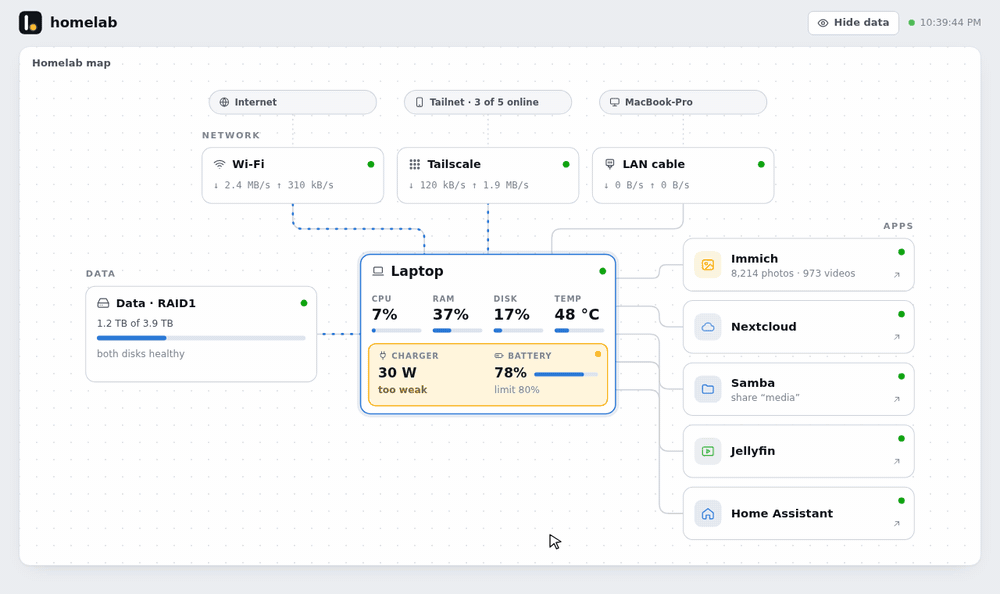
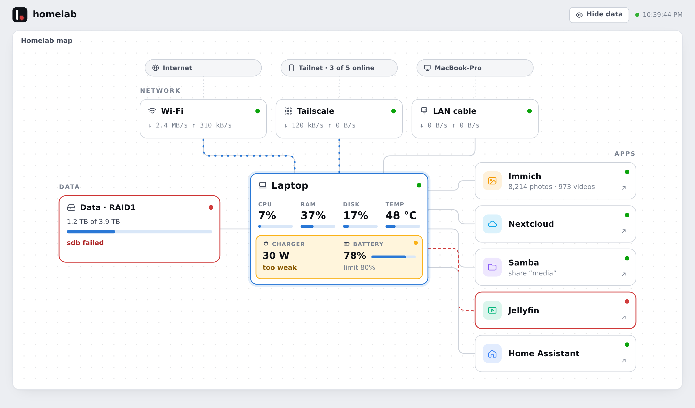
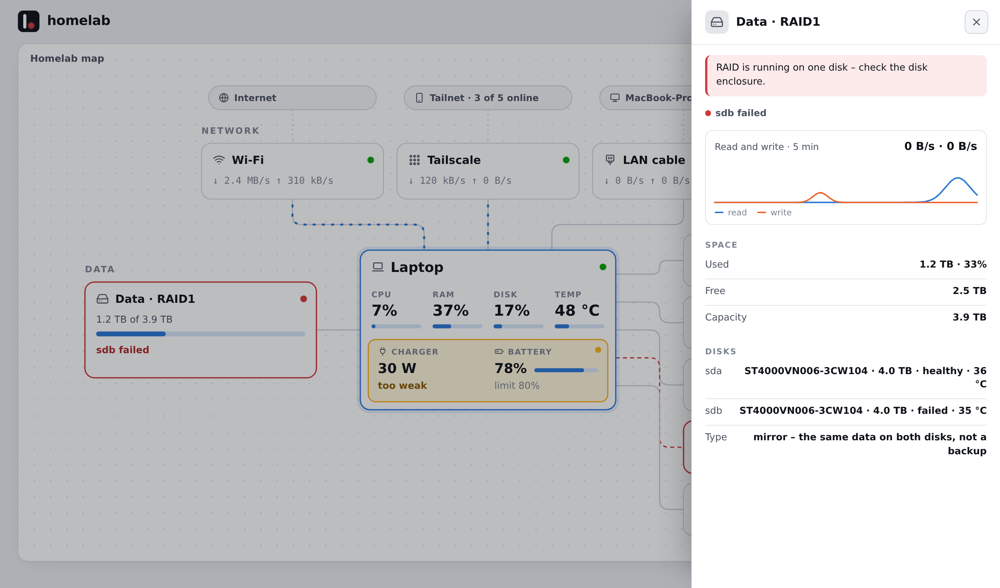
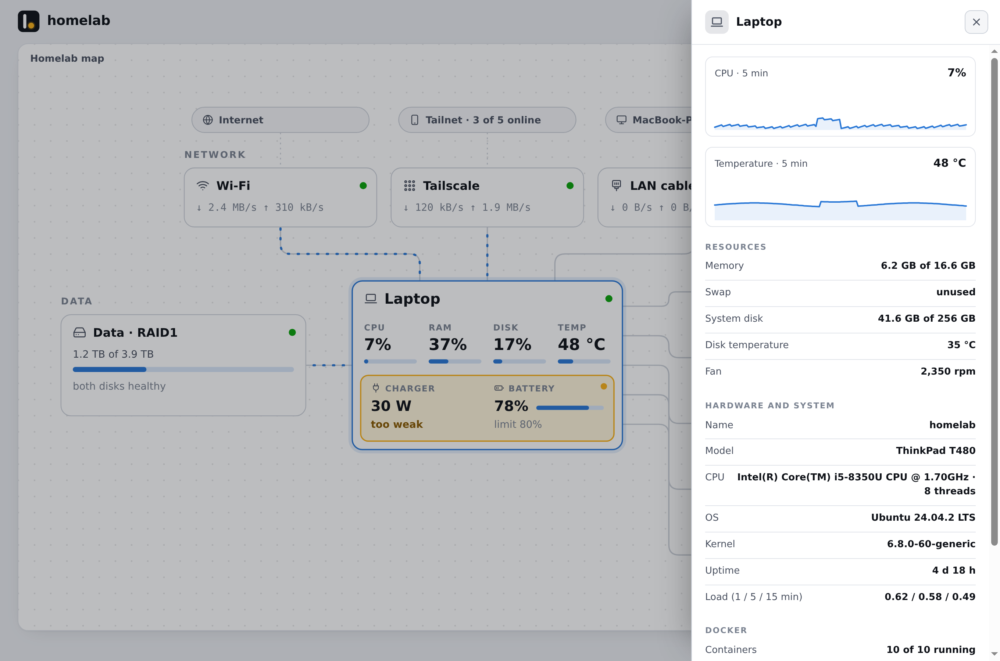
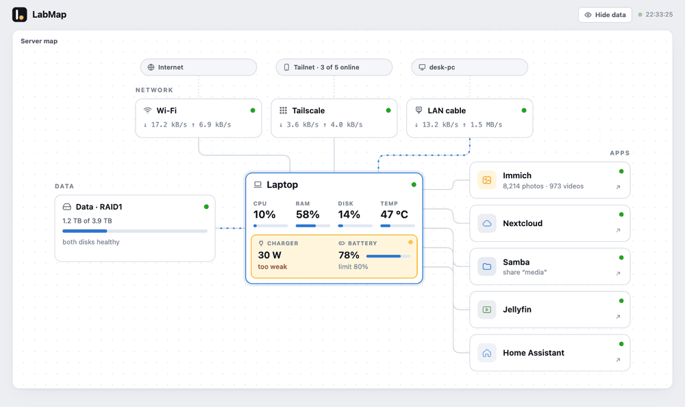
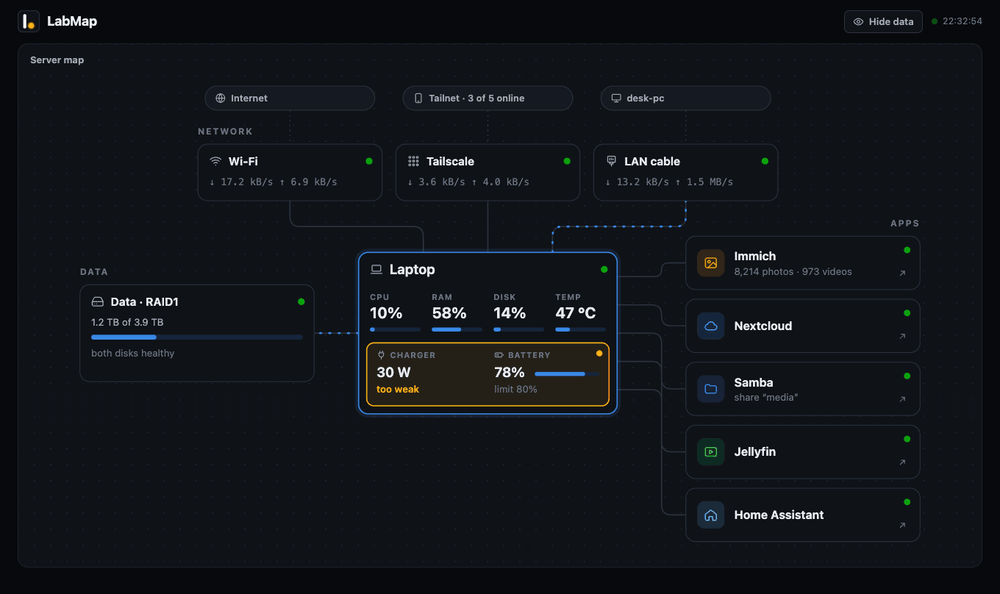
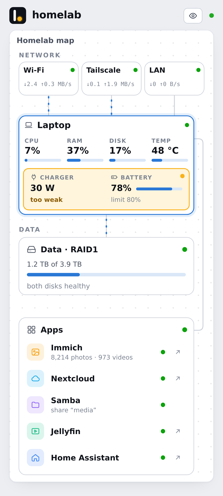
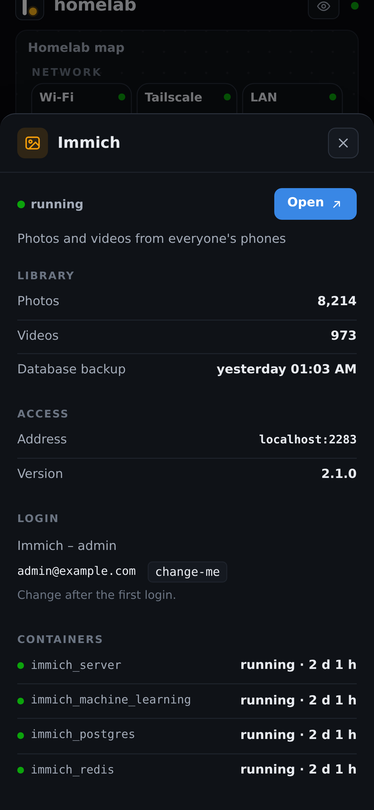
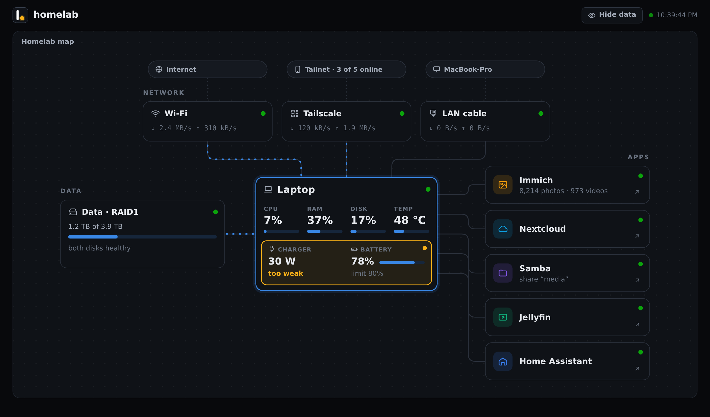
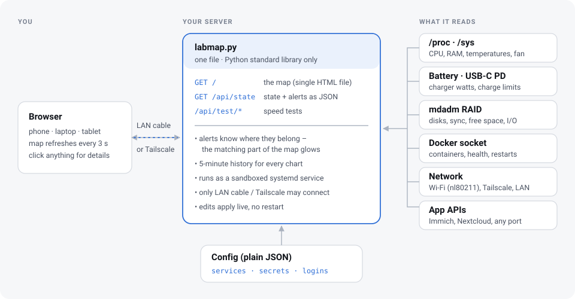

<h1 align="center">
  <picture>
    <source media="(prefers-color-scheme: dark)" srcset="logo/labmap-logo-dark.png">
    
  </picture>
</h1>

**A live map of your home server.** One glance tells you everything is fine, and one click tells you why it isn't.



Most homelab dashboards are a grid of links or a wall of graphs. This one shows how your server is put together: the networks above it, the disks next to it, the apps it runs, and the machine itself in the middle. Every part has a status dot. When something breaks, **that part of the map lights up** yellow or red. Click it to see what happened and what to do.

It is one Python file plus one HTML file. There are no dependencies, no database, no build step and no agents to install.

---

## What it does

### Problems light up where they are

There is no separate list of warnings to read. A degraded RAID turns the disk box red, a stopped container turns its app red, and a weak charger turns the power part of the laptop yellow. Click the glowing part to read a plain-language message.

The dot in the logo is a status light too. It turns yellow or red with the server, and so does the browser tab icon, so you notice a problem even when LabMap sits in a background tab.

<p>
  
  
</p>

What it watches:
- **RAID (mdadm):** missing or unmounted array, a dropped disk, resync progress, mismatched sectors, free space.
- **Machine:** CPU temperature, RAM, system disk, Docker daemon.
- **Containers:** stopped, restarting, or failing health checks, shown on the app they belong to.
- **Power (laptop as a server):** charger unplugged or too weak (USB-C PD wattage), battery draining.
- **Network:** Wi-Fi down, Tailscale down.
- **Apps:** Immich unreachable or its database backup getting old, Nextcloud in maintenance mode.

### Details on click, nothing up front

The map stays quiet. Charts, versions, addresses and containers live behind a click. Every chart keeps the last 5 minutes and shows exact values under the cursor.



### How fast is it, really?

Open a network to run a short speed test:
- **Wi-Fi / internet:** the server measures its own download, upload and latency, next to the link speed the Wi-Fi card negotiated.
- **LAN cable / Tailscale:** your browser measures the connection between your device and the server. Tailscale also shows whether that connection is direct or relayed.



### A privacy switch for screen sharing

**Hide data** blanks out IP addresses, device and tailnet names, versions, ports and saved logins, so you can show LabMap to someone.



### Your apps, one click away

Apps are listed in `services.json`. Each one gets a status (from its containers or its port), a button that opens it, and optionally the logins you keep for it. Docker apps with a published port that aren't listed show up on their own.

```json
{"name": "Jellyfin", "description": "Movies and shows", "port": 8096,
 "icon": "film", "color": "#10b981", "containers": ["jellyfin"]}
```

### Works on the phone, in light and dark

<p>
  
  
  
</p>

---

## How it works



- **`labmap.py`** (about 1,100 lines, Python standard library only) samples the machine every 2 seconds and the slower sources every 10 seconds. It serves the page and a JSON API.
- **`index.html`** (one file with no framework) draws the map as SVG. It adapts to the window width and refreshes every 3 seconds.
- **Configuration** is plain JSON: the apps, an optional Immich API key, and optional logins. Edits apply live. Even a new `labmap.py` hot-swaps itself if it compiles.
- **It keeps running when the data disk is gone.** The service runs from a copy on the system disk, so it can still tell you the RAID is missing.

## Security model

LabMap is built for a home network you control, not for the public internet.

- It runs as a **sandboxed systemd service** (read-only system, no home directories, minimal capabilities).
- Connections are limited at the service level to the **LAN cable and Tailscale**. Others on the Wi-Fi (for example a dorm or office network) can't connect.
- A **Host-header check** blocks DNS rebinding, and a strict CSP is set.
- Speed-test endpoints require a custom header, so other websites can't trigger them.
- The service itself can't reach the internet. The internet test runs `curl` in a throwaway container from an image you already have, against Cloudflare's public speed-test endpoints.
- Saved logins are stored **in plain text** in a local file. They are never shown in privacy mode.

## Status

LabMap started as one person's homelab panel: a ThinkPad running as a server, two USB disks in RAID1, and Immich, Nextcloud and Samba in Docker. The original version runs there every day; this English version was tested on the same machine.

Planned before the first release:
- [x] English UI
- [x] Interface names, RAID device and app URLs in `labmap.env` instead of in code
- [ ] A Docker image
- [ ] More integrations (Jellyfin, Home Assistant, SMART disk health)
- [ ] Translations

## Quick start

Requirements: Linux with systemd and Python 3 (tested on 3.14). Docker, mdadm, Tailscale and a battery are optional – missing parts simply don't appear.

```bash
git clone https://github.com/wojtekbakun/labmap.git
cd labmap
sudo bash install.sh
```

The installer creates `/etc/labmap.env` and `services.json` from the examples, installs the `labmap` service on port 80 and opens the firewall (ufw) for the LAN cable and Tailscale. Then open `http://<server>/`.

## Configuration

| File | What it holds |
|---|---|
| `/etc/labmap.env` | Network interface names, the RAID device and mount point, Immich and Nextcloud URLs. Restart the service after a change: `sudo systemctl restart labmap`. |
| `services.json` | The apps on the map. Edits apply on the next refresh. |
| `secrets.json` | Optional: `{"immich_api_key": "…"}` with the `server.statistics` and `job.read` permissions, for photo counts and the job queue. |
| `logins.json` | Optional: logins shown in an app's details. Plain text, hidden in privacy mode. See `logins.example.json`. |

## License

[MIT](LICENSE)

<sub>Screenshots use demo data.</sub>
